# Help on the Way

**Two iOS apps** for booking someone to come and do a thing — cleaning, repairs,
moving, assembly, errands, yard work, tech help, pets, events, babysitting,
tutoring, senior care, meal prep, or anything you can describe — either **right
now** or **on your calendar**.

| | |
|---|---|
| **Help on the Way** | What customers install. Ask for help, watch it arrive, pay and rate. |
| **HOTW Helper** | What helpers install. Go online, accept offers, work the job, get paid. |

The customer app is two products in one. *Now* works like Uber: the request goes
out to every qualified helper nearby at once, the first to take it is yours, and
you watch them drive to your door. *Later* works like TaskRabbit: pick a day,
pick a slot, and pick the exact person, by rate and reviews and rebook rate.

The two apps are **genuinely linked**. Both read and write one job store in a
shared App Group container, so a request placed in the customer app appears as a
live offer in the helper app within a second, and an accept there flips the
customer's screen to live tracking. When a real helper is on shift, the simulated
dispatcher stands down and waits for a person to tap Accept.

Everything runs on-device. No account, no server, no network calls, no card
fields.

| | |
|---|---|
| 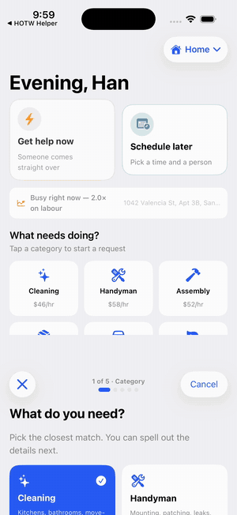 | 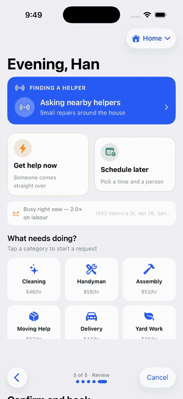 |
| **Asking for help** — five steps, with the price updating as you go | **Two apps, one dispatcher** — the request goes out, a helper accepts in *their* app, tracking lights up in yours |
| 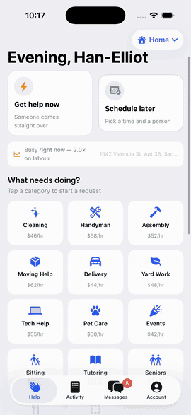 | 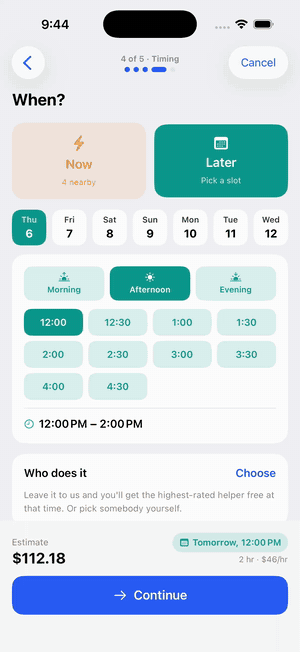 |
| **Name your own rate** — Custom quotes no price, so you set one against what helpers actually charge, and they can accept or counter | **Picking a time** — a day, then a start time grouped by morning, afternoon and evening |

The middle one is the whole point of the repo, so it's worth watching: the
"A helper is looking at this" screen is the customer app *declining to
auto-assign* because a real helper app is on shift. The accept that follows comes
from a different install.

<details>
<summary><b>More screens</b> (stills)</summary>

| | | |
|---|---|---|
| 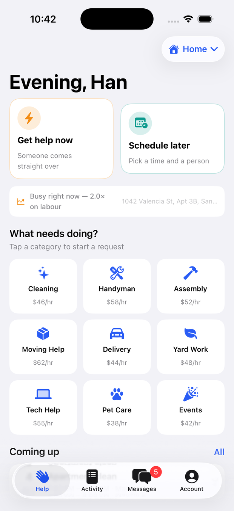 | 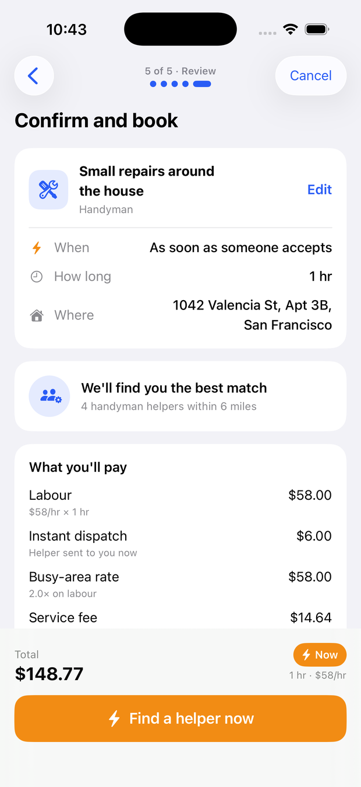 | 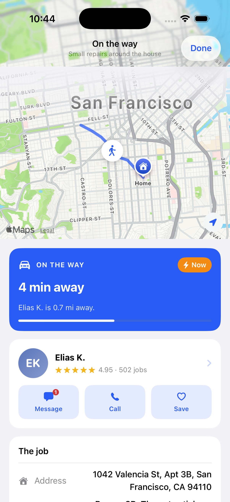 |
| Now or Later, with live demand | An itemised quote before you commit | Who was asked, who passed |
| 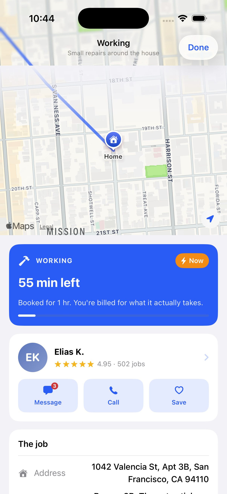 | 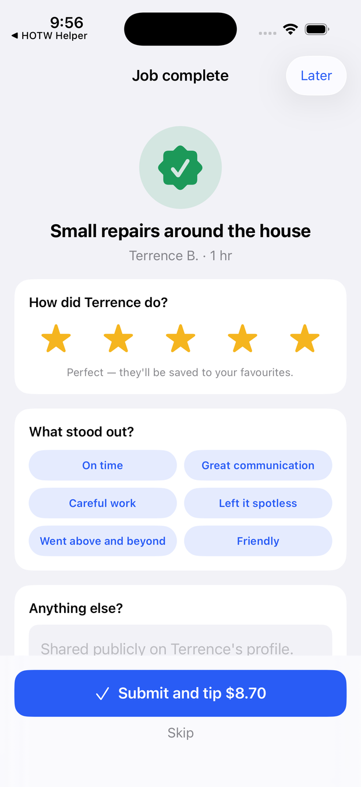 | 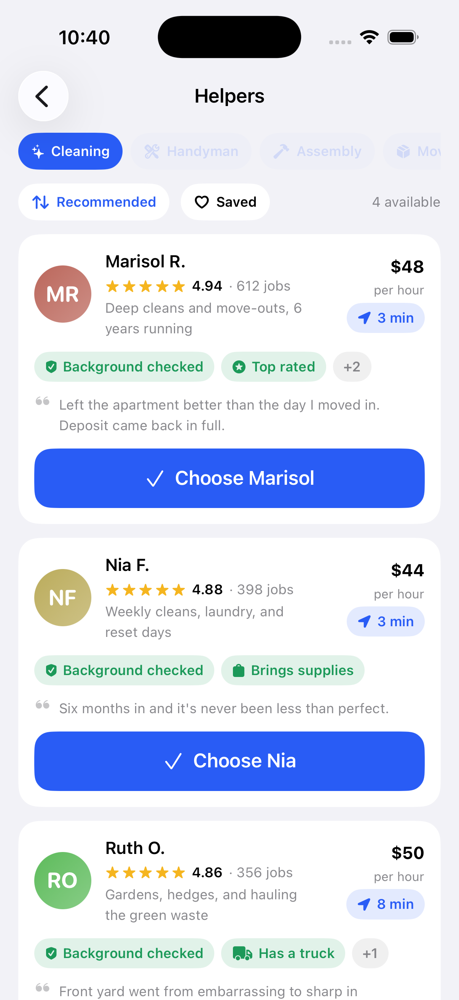 |
| Route, ETA and status, live | Stars, compliments, a tip off labour | Compare the actual people |
| 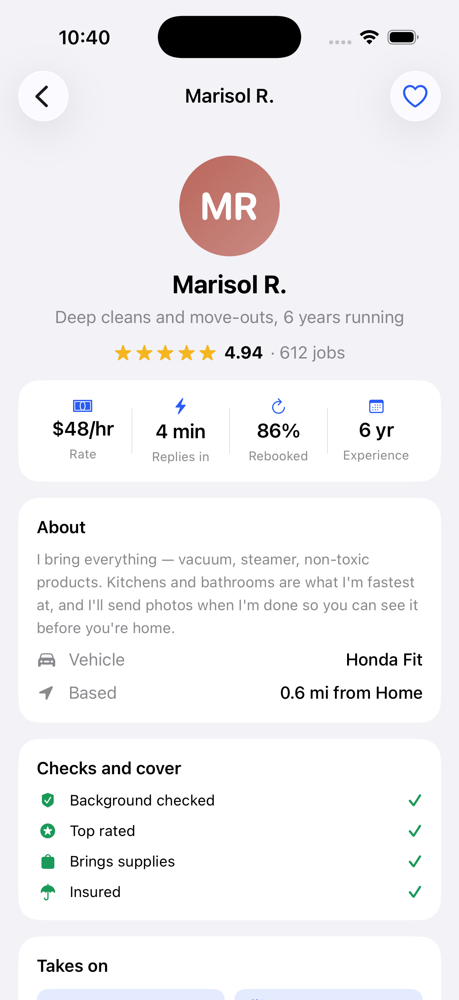 | 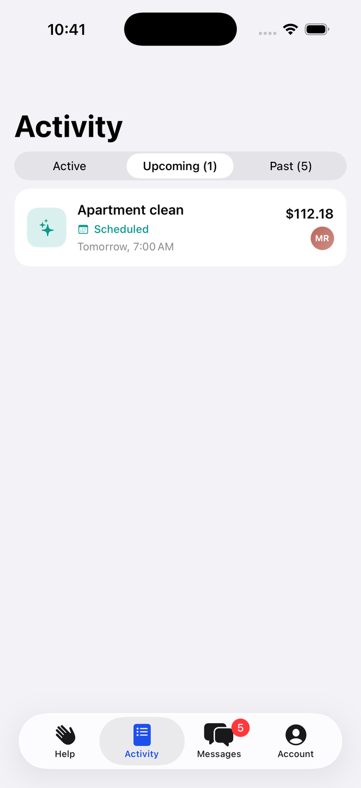 | 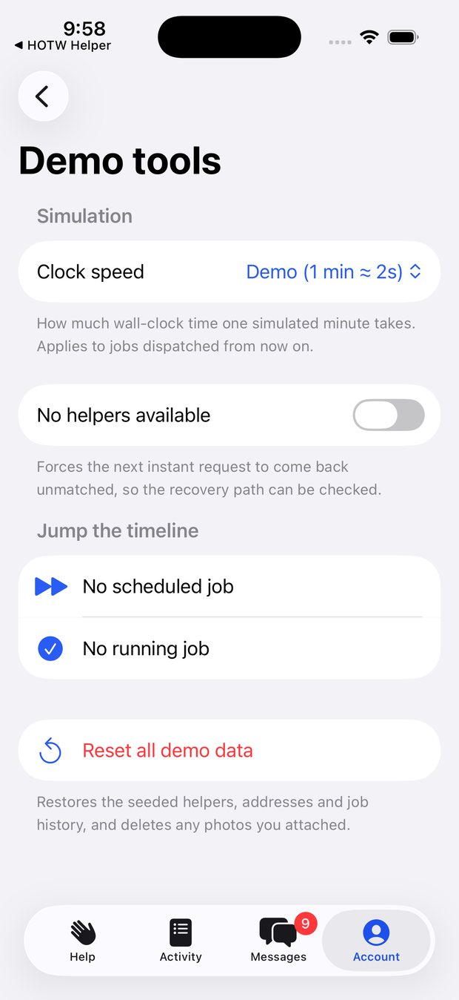 |
| Reviews, checks, rebook rate | Scheduled work, with its window | Drive the simulation by hand |
| 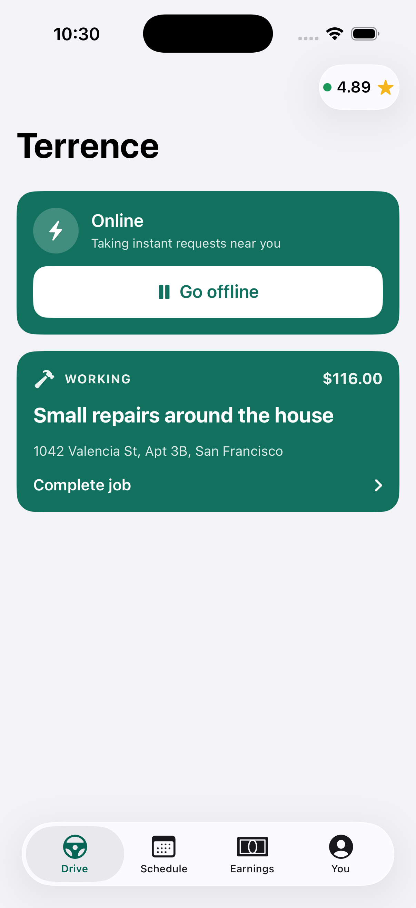 | 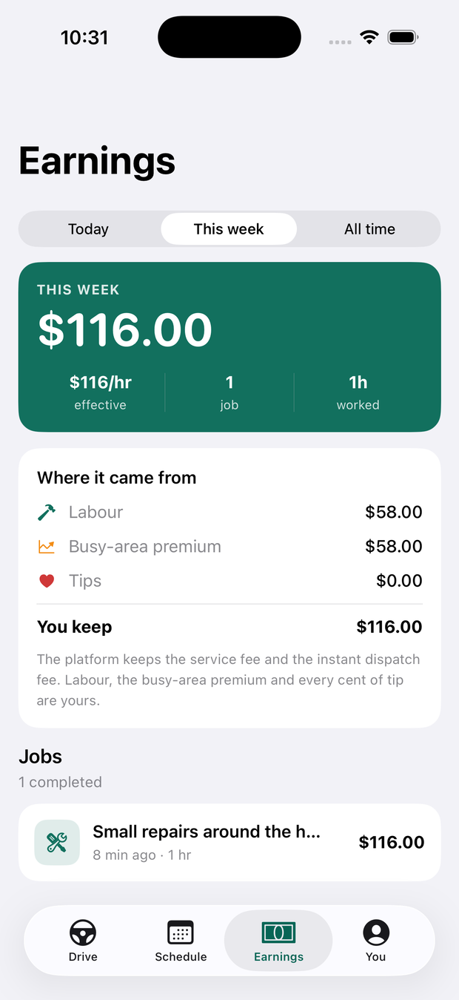 | 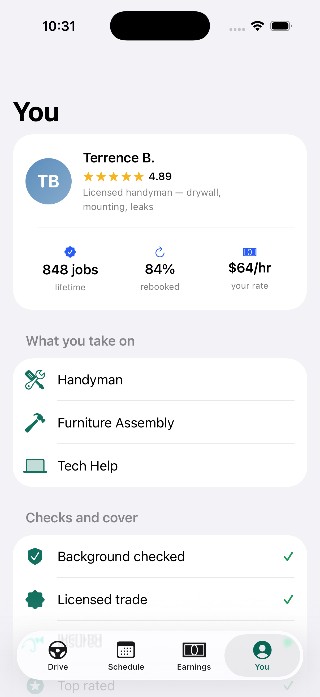 |
| On shift, offers land here | What you keep, and what the platform took | Checks, cover, and the live link |

</details>

---

## The two paths

### Now

1. Pick a category, describe the job, set a rough duration, attach photos.
2. Confirm the address and see the quote — labour, the instant dispatch fee, and
   the busy-area rate if the neighbourhood is under pressure.
3. The request broadcasts. The matching screen shows who was asked, who passed,
   and who took it — not a spinner.
4. A helper accepts and a dispatch plan is built: a route, an ETA, a work window.
5. Track it on a map. Message them. Cancel with a policy you can read.
6. It completes, the bill is settled against the time it actually took, and you
   rate and tip.

If nobody takes it, you get a recovery path rather than a dead end: ask again, or
roll the same request into a scheduled booking at the lower rate.

### Later

1. Same request, but the timing step opens a calendar instead.
2. Slots are real: an hour's notice minimum, a 7am–8pm start window, work must
   finish by 10pm, and a job long enough to run past closing simply isn't
   offered that late.
3. Times are grouped **morning / afternoon / evening** rather than listed. A
   trading day is 27 half-hour starts, and showing them all made the step a wall
   of identical buttons; people think "some afternoon" before they think "3:30".
   Each segment carries its own count and greys out when it's full, and because a
   part of day settles AM or PM, the buttons drop the meridiem and read `1:00`.
4. Pick your own helper — filter by category, sort by recommended, rating, rate
   or distance, read their reviews — or leave it and get the best available.
5. Booking a day or more out earns 5% off labour. No dispatch fee, no surge.
6. When its start time comes round, the booking turns itself into a live job and
   the tracking screen lights up.

---

## What's in it

**Requesting** — five-step flow (category → details → location → timing →
review) with a running price pinned to the bottom the whole way. Photo
attachments, per-category duration presets and minimums, access notes, promo
codes, payment selection.

**Pricing** — labour, category block minimums, an instant dispatch fee,
demand-based surge on labour only, a planned-ahead credit, a service fee with a
floor, tax, and a settlement pass that re-bills overtime in quarter hours.
Every line is shown, every line is explained.

**Dispatch** — a synthetic street route, a moving vehicle marker with heading, an
ETA that counts down, a status timeline, and a compressed demo clock so a
two-hour job plays out in a few minutes.

**Helpers** — sixteen fixtures with rates, ratings, badges, skills, vehicles,
bios, reviews and a derived rebook rate. Favourites, profiles, per-helper booking
history.

**The rest** — activity split into active / upcoming / past, receipts, a message
thread per job with keyword-aware replies, saved addresses with a map pin, a
ratings flow with compliments and tipping off labour, and an account tab.

**Naming your own rate** — Custom has no going rate, because the app has none to
quote for work it doesn't know. You name what you'll pay against the band helpers
actually charge, and whoever picks it up accepts, counters, or walks away. Any
category can be haggled the same way.

**Vetting** — babysitting, tutoring and senior care sit behind enhanced checks:
those categories are scheduled-only, need more notice, and are only ever offered
to helpers carrying the right credentials. The customer sees which checks apply
and why.

**Reviews that are actually published** — a rating appends a real review to the
helper's profile and their rating is rederived from it, weighted by the jobs
behind them so one bad night can't erase eight hundred good ones.

**Your account** — edit your details, add and remove cards (brand, last four,
expiry, cardholder and billing address only — a card number is never stored),
manage addresses, and delete the account outright. Deletion is refused while a
helper is mid-job or holding a booked slot.

**Demo tools** (Account → Demo tools) — change the clock speed, force the
"nobody available" path, pull a scheduled job forward, finish a running job
early, or reset everything.

---

## The helper app

Sign in as any of the sixteen roster helpers — there's no auth, so "signing in" is
picking which of them you are, which is also what makes the two-app demo work:
you can be the person the customer app just dispatched to.

**Drive** — one big GO button, then offers. Each offer card leads with what the
job pays *you* (labour plus the busy-area premium, before tips), then distance,
drive time and time on site, then the job itself with the customer's notes and
photos. Accept or Pass.

**Working a job** — one primary action that walks the whole state machine: *Start
driving → I've arrived → Start work → Complete job*. Alongside it: the route, a
Directions hand-off to Apple Maps, the access notes, the category checklist, and
a chat thread that's the mirror of the customer's.

**Earnings** — today / this week / all time, with the split shown honestly:
labour, busy-area premium and tips are the helper's; the service fee and the
instant dispatch fee are the platform's; tax belongs to neither and is passed
through. Effective hourly is computed across the period, because that's the
number a helper actually judges a platform by.

**Schedule** — bookings a customer assigned to you by name, with the window and
the pay.

### How the two apps talk

One JSON document in `group.com.hanelliotphan.helpontheway`, with three rules:

1. **Every write is a read-modify-write.** Nothing writes a snapshot it loaded a
   while ago — that's how you erase the other app's work. `SharedStore.mutate`
   reloads, applies, saves.
2. **A `revision` counter drives sync.** Each app remembers the last revision it
   wrote or read and reloads when the file moves past it. Presence heartbeats
   deliberately *don't* bump it, or both apps would reload the whole job list
   once a second for nothing.
3. **Helper actions reshape the plan, they don't set status.** Tapping "I'm here"
   shortens `travelMinutes` until `arrivesAt` is now. Because status is derived
   from the plan, both apps compute the identical phase with zero coordination.

When a helper is on shift, `DemoBackend` yields `.awaitingLiveHelper` and stops —
no simulated accept steals the job from a real person. If nobody taps Accept
within 45 seconds, the customer app falls back to the simulated dispatcher rather
than leaving the request hanging.

**Known limitation:** two writes landing in the same instant can still lose one.
There's no file lock, because a pair of apps driven by one person's thumbs never
actually races, and the locking would buy correctness nobody in this demo can
observe.

---

## How it's built

SwiftUI, iOS 17+, no third-party dependencies. `@Observable` throughout, with a
single `AppSession` holding all state; views read it and call methods on it, and
nothing else mutates a job.

```
Sources/
  Shared/       Compiled into BOTH apps — every model and every rule.
                Models, Pricing, Dispatch, Matching, Scheduling, Earnings,
                SharedStore, DemoBackend, MockData, Persistence, PhotoStore,
                Theme, Components
  CustomerApp/  HelpOnTheWayApp, RootView, AppSession + Features/
                (Onboarding, Home, Request, Matching, Tracking, Activity,
                 Rating, Chat, Helpers, Profile)
  HelperApp/    HelperAppMain, HelperSession, DriveView, ActiveJobView,
                EarningsView
Tests/          Pricing, Dispatch, Scheduling, Matching, RequestDraft,
                Persistence, HelperActions, Payouts, Presence
```

Roughly 12,500 lines of app and 3,800 of tests across 55 files. All the helper's
*logic* lives in `Shared` rather than `HelperApp` — that's what lets one test
target cover both apps without a second `@testable import`.

### The one idea worth knowing

**A live job's status is a pure function of the current time.** A `DispatchPlan`
stores absolute dates for every phase boundary — accepted, en route, arrived,
working, done — plus the route and the timescale. `plan.status(at: now)` reads
the phase off the clock; nothing is stepped along by hand and no state machine
can drift.

That one decision pays for itself repeatedly. Quit the app mid-job and reopening
lands you exactly where you should be, not back at the start. The ETA, the
vehicle's position on the map, and the progress bar all derive from the same
function. And it means the whole timeline is testable without a simulator, a
timer, or a single `sleep`.

The demo clock rides on the same idea: `timeScale` is wall-clock seconds per
simulated minute. Sixty is real time, two is the demo, and the ETA a customer
reads is always in simulated minutes either way.

### Other choices

- **Money is `Decimal`, built from whole units.** `Decimal.usd(2, 49)`, never a
  float literal. Every intermediate rounds to cents with `NSDecimalRound`.
- **Determinism over randomness.** Who declines a request, which route gets
  drawn, how much a job runs over — all seeded off the job's `UUID` via
  SplitMix64. The same booking always tells the same story, which matters more in
  a demo than true randomness does.
- **Demand is data, not a clock read inside the pricing code.** `DemandIndex` is
  a struct you can construct, so surge is pinned in tests instead of depending on
  what time the suite runs.
- **`DemoBackend` is async and has latency.** Every call the UI makes is
  `await`ed against a plausible delay, so loading states are exercised honestly.
  Swap it for `URLSession` and nothing above it changes.
- **Photos live on disk, not in the snapshot.** Jobs store filenames; the JSON
  save stays fast.
- **No app icon or asset catalog.** Avatars are drawn from initials and a stored
  hue, so a person is the same colour on every screen they appear on.

---

## Running it

The `.xcodeproj` is generated and gitignored; `project.yml` is the source of
truth.

```bash
brew install xcodegen
```

```bash
xcodegen generate && open HelpOnTheWay.xcodeproj
```

Or straight to a simulator:

```bash
xcodebuild -project HelpOnTheWay.xcodeproj -scheme HelpOnTheWay -sdk iphonesimulator -destination 'platform=iOS Simulator,name=iPhone 17 Pro' build
```

Both apps, installed side by side on one simulator:

```bash
for S in HelpOnTheWay HelpOnTheWayHelper; do xcodebuild -project HelpOnTheWay.xcodeproj -scheme "$S" -sdk iphonesimulator -destination 'platform=iOS Simulator,name=iPhone 17 Pro' build; done
```

To see the pair work: open **HOTW Helper**, sign in as Terrence B., tap **Go
online**. Switch to **Help on the Way**, tap Handyman, book it. The matching
screen says *"A helper is looking at this"* instead of auto-assigning. Switch back
to the helper app — the offer is there. Accept it, switch back, and the customer
app is on live tracking.

Note the apps are ad-hoc signed (`CODE_SIGN_IDENTITY: "-"`) rather than unsigned:
the simulator only honours the App Group entitlement on a signed binary, and
without it the two apps can't see each other.

## Tests

350 tests in 29 suites, written with Swift Testing. All logic-only — no UI tests,
no waiting.

```bash
xcodebuild -project HelpOnTheWay.xcodeproj -scheme HelpOnTheWay -sdk iphonesimulator -destination 'platform=iOS Simulator,name=iPhone 17 Pro' test
```

What they cover:

| Suite | What it pins down |
|---|---|
| Pricing | Block minimums, cent-exact labour, surge on labour only, the planned-ahead credit's 24-hour boundary, the service-fee floor, promo caps, and that the total equals its parts |
| Cancellation policy | Free while searching, the minute of grace after accept, the two-hour scheduled window |
| Dispatch timeline | Every phase boundary, ETA countdown, that status is pure and idempotent, that a compressed clock reports the same minutes as a real one |
| Routing | Deterministic routes, exact endpoints, clamped traversal, degenerate inputs, the ETA floor |
| Scheduling | Notice window, opening hours, jobs that would run past closing, the horizon, that `nextSlot` is bookable at every hour of the day, and that morning/afternoon/evening partition a day's slots exactly — nothing lost, nothing duplicated |
| Slot labels | No meridiem on slot buttons, no leading zero on single-digit hours, and the window summary keeping its AM/PM |
| Matching | Category filtering, deterministic ranking, favourite boost and its bounds, exclusion fallthrough, every sort order |
| Fixtures | That the seeded roster and history are internally consistent |
| Request draft | Category switches resetting duration and dropping incompatible helpers, slots sliding when a job gets longer, promo handling, the step machine |
| Persistence | Round-tripping the snapshot, both timing cases, and an in-flight dispatch plan |
| Helper actions | Each plan mutator lands its phase on "now", arriving early or late, and that every earlier moment still derives the phase it was in |
| Payouts | The helper/platform split, that tax is neither side's income, overtime, effective hourly |
| Presence | On and off shift, category matching, and that presence survives suspension |

### Bugs these caught

**The booking horizon** was measured as "this time of day, fourteen days out",
which silently trimmed every slot past the current hour on the picker's last day.
Fixed in [Scheduling.swift](Sources/Shared/Scheduling.swift).

**Presence was a heartbeat with a 12-second window** — wrong for the worst
possible reason. Both apps live on one device, so the helper app is suspended the
instant you switch to the customer app to place a request; its heartbeat always
went stale and every request auto-matched before a person could accept. Presence
is now a latch that survives backgrounding, with the customer app's bounded wait
as the safety valve. Regression test: *"Presence survives the app being suspended
for a long time."*

**The customer app never left the matching screen** when a real helper accepted.
The trigger asked "did this job become live?" — but `.searching` is *already* a
live status, so the test could never fire for the one case that mattered. It now
compares before/after status per job.

---

## What's deliberately not here

- **No real payments.** Cards are brand-and-last-four fixtures. There is no field
  anywhere in the app that accepts a card number, and adding one is out of scope.
- **No real dispatch network.** With no helper app on shift, `DemoBackend`
  simulates who declines and who accepts. With one online, the offer is real.
- **No geocoder.** New addresses drop a pin near the demo neighbourhood and let
  you nudge it. Everything downstream of a coordinate works properly.
- **No real routing.** Routes are synthetic polylines rather than `MKDirections`,
  which keeps the demo offline and identical on every run.
- **No push, no auth, no server.** Onboarding takes a name and a phone number and
  keeps them on the device.
